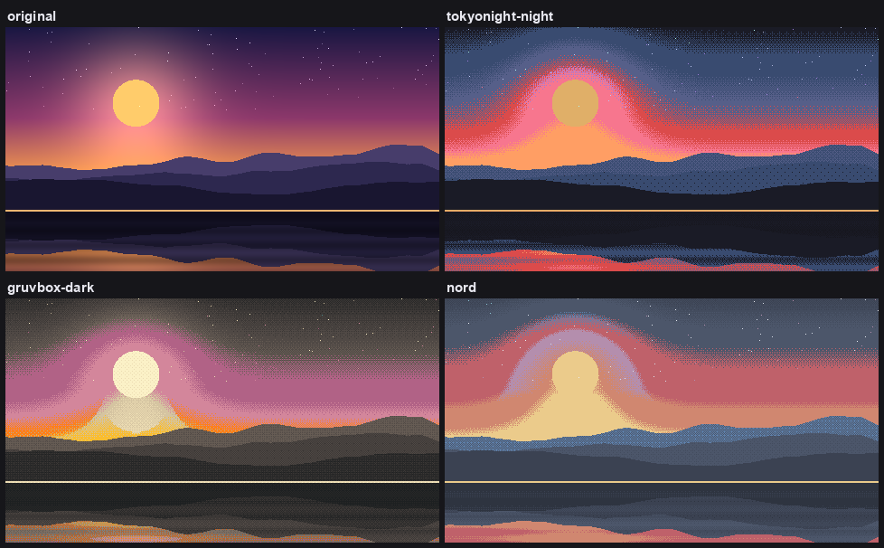

# colorscheme-convert

Recolor any image to match your terminal or editor color scheme — wallpapers,
screenshots, diagrams. Ships with 13 schemes and reads your own from JSON.



*`docs/scene.png` run through `convert.py -t <scheme> -d bayer`.*

Colors are matched in [Oklab](https://bottosson.github.io/posts/oklab/), so
"closest color" means closest as the eye sees it rather than closest in the RGB
cube. That is the difference between a recolored image that looks right and one
where the greens go muddy.

## Install

Needs Python 3.9+.

```sh
git clone https://github.com/NotebookNomad/colorscheme-convert
cd colorscheme-convert
python3 -m venv .venv && .venv/bin/pip install -r requirements.txt
```

## Use

```sh
.venv/bin/python convert.py wallpaper.png
# -> wallpaper-tokyonight-night.png

.venv/bin/python convert.py wallpaper.png -t gruvbox-dark
# -> wallpaper-gruvbox-dark.png
```

Pass several images to convert them in one go. Alpha channels are preserved.

Two flags cover most of what you'll want:

```sh
-t nord      # pick a scheme      (--list-themes shows them all)
-b 0.7       # darker; -b 1.4 lighter
```

Try it on `sample.png`, a built-in test chart, to see what a scheme does to a
full range of hues and lightnesses.

## Themes

`tokyonight-night` *(default)* · `tokyonight-storm` · `tokyonight-moon` ·
`tokyonight-day` · `gruvbox-dark` · `gruvbox-light` · `catppuccin-mocha` ·
`catppuccin-latte` · `nord` · `dracula` · `solarized` · `rose-pine` ·
`everforest-dark`

`--show-palette -t nord` prints a scheme's colors and writes a swatch image.

### Adding your own

Drop a `.json` file into `~/.config/colorscheme-convert/themes/`. The filename
is the theme name, so `synthwave.json` becomes `-t synthwave`. Naming it after a
built-in overrides that built-in. To try one without installing it, use
`--theme-file path.json`.

The simplest theme is a list of colors:

```json
["#0b0f14", "#1b262c", "#3a5a6c", "#7fa1b3", "#c9d6db", "#e85d75", "#f0a35e"]
```

Naming them is optional, and lets you add two hints:

```json
{
  "colors": { "bg": "#1a1b26", "mid": "#565f89", "fg": "#c0caf5", "red": "#f7768e" },
  "ramp": ["bg", "mid", "fg"],
  "exclude": ["mid"]
}
```

- **`ramp`** — the dark-to-light neutral spine used by `-m gradient`. Leave it
  out and one is worked out for you from the least saturated colors.
- **`exclude`** — colors to skip when matching. Useful for shades that sit almost
  on top of another one and only add banding. `--full-palette` puts them back.

Both `#rgb` and `#rrggbb` work. The files in `themes/` use this same format, so
copying one is the easiest way to start.

## Methods

| `-m` | What it does | Best for |
| --- | --- | --- |
| `nearest` *(default)* | Snaps every pixel to the closest scheme color. Output contains **only** scheme colors. | Wallpapers, screenshots, a flat poster look |
| `blend` | Mixes nearby scheme colors. Smooth, but goes off-palette. | Photographs, gradients |
| `gradient` | Maps lightness onto the scheme's neutral ramp. | A monochrome, tinted look |

## Options

| Flag | Effect |
| --- | --- |
| `-o PATH` | Output path (one input image only) |
| `-t NAME` | Scheme to use |
| `--theme-file PATH` | Use a scheme from a JSON file |
| `--list-themes` | Show available schemes |
| `-m METHOD` | `nearest`, `blend`, or `gradient` |
| `-d KIND` | Dither: `bayer` (ordered) or `floyd` (error diffusion). Trades hard color bands for texture, staying on-palette. `nearest` only |
| `-b N` | Brightness. Below `1.0` darkens, above lightens |
| `-k 0..1` | Keeps some of the original lightness, restoring detail that snapping flattened. `0.4`–`0.6` suits photos. Goes off-palette |
| `-c N` | Below `1.0` matches on lightness (calmer), above chases hue (more colorful) |
| `-s N` | Mix radius for `blend`. Smaller is punchier, larger is smoother |
| `--ramp all` | Gradient-map over every color instead of the neutral spine, for deliberate rainbow banding |
| `--full-palette` | Also match against a theme's `exclude` colors |
| `--no-normalize` | Keep the image's original exposure instead of stretching it across the scheme's lightness range |
| `--show-palette` | Print a scheme and write a swatch image |

## Recipes

```sh
# Wallpaper, on-palette, softened banding
.venv/bin/python convert.py wall.png -d bayer

# Photo that keeps its detail
.venv/bin/python convert.py photo.png -m blend -k 0.5 -s 0.06

# Pixel art
.venv/bin/python convert.py sprite.png -d floyd -t gruvbox-dark

# Darker result
.venv/bin/python convert.py wall.png -b 0.7
```

## As a library

```python
from PIL import Image
from convert import convert_image, resolve_palette
from theme import get_theme

palette, ramp = resolve_palette(get_theme("catppuccin-mocha"))
out = convert_image(Image.open("in.png"), palette, ramp_rgb=ramp,
                    method="blend", keep_lightness=0.4)
out.save("out.png")
```

`convert_image` and `convert_array` take the same options as the flags above.

## Notes

Tokyo Night values follow
[folke/tokyonight.nvim](https://github.com/folke/tokyonight.nvim); the other
schemes were transcribed from their published palettes. They are plain JSON in
`themes/`, so a wrong hex is a one-line fix — corrections welcome.
